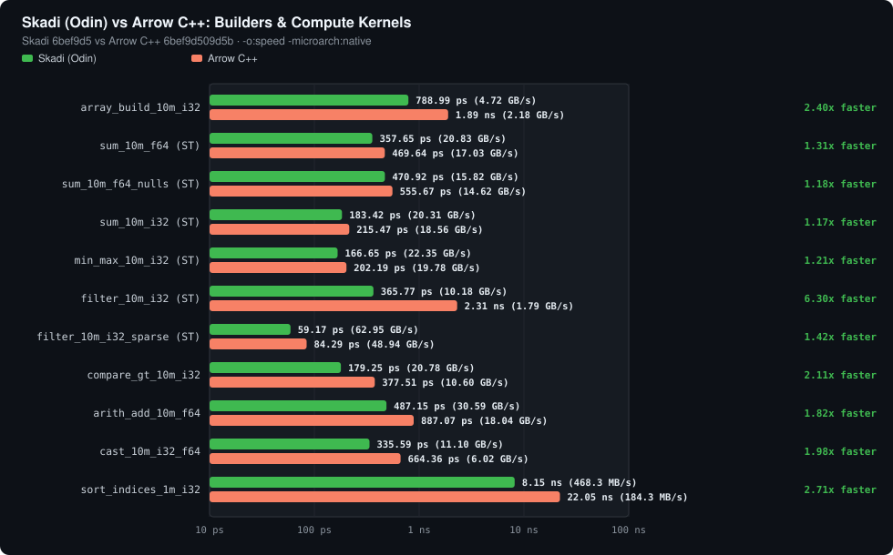

# Skadi (`package skadi`)

[](https://github.com/boxxxie/skadi/actions/workflows/ci.yml)
[](CHANGELOG.md)
[](https://odin-lang.org/)
[](LICENSE)
[](https://arrow.apache.org/docs/format/Columnar.html#serialization-and-interprocess-communication-ipc)

A native [Apache Arrow](https://arrow.apache.org/) implementation in [Odin](https://odin-lang.org/) (`package skadi` and optional `package pipeline` in [`skadi/pipeline/`](skadi/pipeline/sleipnir_pipeline.odin)) — providing a columnar in-memory format, SIMD and parallel compute kernels, companion compressed encodings, and Arrow IPC (Feather v2) serialization with explicit memory management.

Files and streams written by Skadi are readable directly by **PyArrow** and **Apache Arrow C++**, and vice-versa.

## Features

- **Spec-Aligned Columnar Memory** — 64-byte aligned buffers ([`Buffer`](skadi/buffer.odin)), packed little-endian validity bitmaps ([`bitmap.odin`](skadi/bitmap.odin)), `O(1)` zero-copy slicing, Arrow C Data Interface buffer layout, and a single-threaded [`Buffer_Pool`](skadi/buffer_pool.odin) allocator with power-of-two/256 KB bucketing, 25% large-block slack reuse, hit/miss telemetry, and a 128 MB LRU eviction cap for `>4 MB` blocks.
- **Type System & Companion Encodings** — 16-variant tagged-union `DataType` ([`types.odin`](skadi/types.odin)): `Null_Type`, `Bool_Type`, `Int8`–`Int64`, `UInt8`–`UInt64`, `Float32`/`Float64`, `String_Type`/`Binary_Type` (`i32` offsets), and `Large_String_Type`/`Large_Binary_Type` (`i64` offsets), paired with cache-optimized companion structures: [`Umbra_Array`](skadi/umbra.odin) (16-byte German strings with 12-byte inline / 4-byte prefix fast paths), [`RLE_Array(T)`](skadi/rle.odin) (run-end encoding with `O(runs)` kernels), and [`Dict_Array(T)` / `Str_Dict_Array`](skadi/dict.odin) (dictionary encoding with `O(n_dict)` min/max and integer-histogram aggregations).
- **Zero-Copy Builders** — raw-buffer [`Primitive_Builder(T)`](skadi/builders.odin) and variable-length builders ([`var_length.odin`](skadi/var_length.odin)) with uninitialized data allocation, lazy validity bitmaps, `string_builder_reserve_data`, `O(1)` buffer-ownership transfer on `finish()`, `Buffer_Pool` integration, and `i32` offset overflow checks.
- **SIMD Compute, Selection Vectors & Operator Fusion** — reductions (`sum`, `min`/`max`, `mean`, `count`), selectivity-hybrid `filter` (64-bit `tzcnt` + 256-entry byte-mask LUT), software-prefetched `take`, numeric `cast`, element-wise arithmetic, monomorphised comparisons, and `sort_indices` (packed 8-byte `(key_u32, idx_u32)` LSD radix sort for integers; prefix radix + tie-break merge sort for strings and Umbra arrays); target-scoped AVX2/SIMD reductions ([`compute_simd.odin`](skadi/compute_simd.odin)); lazy [`Selection`](skadi/selection.odin) vectors with L1d-resident `u16` morsels ([`hardware_config.odin`](skadi/hardware_config.odin)); and zero-allocation single-pass fused operators (`compute_sum_where`, `compute_agg_where_compare`).
- **Parallel Thread Pool & Sleipnir Actor Pipeline** — persistent work-stealing `*_parallel` kernels ([`compute_parallel.odin`](skadi/compute_parallel.odin), [`thread_pool.odin`](skadi/thread_pool.odin)), plus the cache-resident [`Morsel_Pipeline`](skadi/pipeline/sleipnir_pipeline.odin) backed by [`deps/sleipnir/actor/`](deps/sleipnir/actor/doc.odin) (`Envelope_Pool` + wait-free `Sharded_SPSC_Mailbox`) for super-morsel fused aggregations, dictionary histograms, and zero-merge-pass MSB-bucket parallel sorting.
- **Zero-Copy Arrow IPC (Feather v2)** — file (random batch access) and stream (sequential) readers and writers ([`ipc.odin`](skadi/ipc.odin)) using a self-contained FlatBuffers encoder/decoder, vectored `writev` zero-copy writes, POSIX `mmap` zero-copy reads (`use_mmap=false` heap-copy fallback), atomically refcounted `Record_Batch._ipc_backing` lifetimes, and bounds/offset validation (`validate=true`).

## Quick Start

Import the `skadi` package via a relative path or `-collection:skadi=...` (and `skadi/pipeline` for Sleipnir actor execution).

```odin
package main

import oa "skadi"
import "core:fmt"

main :: proc() {
    // Build a Float64 array (with one null).
    b := oa.builder_make(f64, 1024)
    for i in 0..<1000 { oa.builder_append(&b, f64(i)) }
    oa.builder_append_null(&b)
    arr, _ := oa.builder_finish(&b)      // zero-copy: buffers move into the Array
    oa.builder_destroy(&b)

    // Compute over it.
    total, valid := oa.compute_sum(&arr)
    fmt.printfln("sum=%.0f over %d non-null values", total, valid)

    // Wrap it in a schema + record batch and write a PyArrow-compatible IPC file.
    schema, _ := oa.schema_make([]oa.Field{ oa.field_make("v", oa.Float64_Type{}) })
    defer oa.schema_free(&schema)
    batch, _ := oa.record_batch_make(&schema, []oa.Array{arr})  // batch owns arr's buffers
    defer oa.record_batch_free(&batch)
    oa.ipc_write_file("data.arrow", &schema, []oa.Record_Batch{batch})

    // Read it back (zero-copy: columns are views into the mmap'd file).
    sc, batches, ok := oa.ipc_read_file("data.arrow")
    fmt.println("read ok:", ok, "batches:", len(batches))
    oa.schema_free(sc); free(sc)
    for bx in batches { bc := bx; oa.record_batch_free(&bc) }
    delete(batches)
}
```

Reading the same file in Python:

```python
import pyarrow.ipc as ipc
table = ipc.open_file("data.arrow").read_all()
```

### Core API Overview

| Domain | Primary Types & Procedures | Source |
|---|---|---|
| Memory & Hardware | `Buffer`, `Buffer_Pool`, `bitmap_*`, `hardware_config_get` | [`buffer.odin`](skadi/buffer.odin), [`buffer_pool.odin`](skadi/buffer_pool.odin), [`bitmap.odin`](skadi/bitmap.odin), [`hardware_config.odin`](skadi/hardware_config.odin) |
| Types & Containers | `DataType`, `Array`, `Schema`, `Record_Batch`, `Table`, `Chunked_Array` | [`types.odin`](skadi/types.odin), [`array.odin`](skadi/array.odin), [`schema.odin`](skadi/schema.odin), [`record_batch.odin`](skadi/record_batch.odin), [`table.odin`](skadi/table.odin) |
| Builders | `builder_make`, `string_builder_make`, `binary_builder_make`, `large_string_builder_make`, `large_binary_builder_make` | [`builders.odin`](skadi/builders.odin), [`var_length.odin`](skadi/var_length.odin) |
| Serial & Parallel Compute | `compute_sum`, `compute_min_max`, `compute_mean`, `compute_count`, `compute_filter`, `compute_take`, `compute_sort_indices`, `compute_cast`, `compute_arithmetic`, `*_parallel` | [`compute.odin`](skadi/compute.odin), [`compute_simd.odin`](skadi/compute_simd.odin), [`compute_parallel.odin`](skadi/compute_parallel.odin) |
| Selection & Fusion | `Selection`, `compute_compare`, `compute_select_compare`, `selection_refine_compare`, `compute_sum_where`, `compute_agg_where_compare`, `compute_sel_2pred_sum` | [`selection.odin`](skadi/selection.odin), [`compare.odin`](skadi/compare.odin), [`compute_fused.odin`](skadi/compute_fused.odin), [`fusion.odin`](skadi/fusion.odin) |
| Companion Encodings | `Umbra_Array`, `RLE_Array(T)`, `Dict_Array(T)`, `Str_Dict_Array` | [`umbra.odin`](skadi/umbra.odin), [`rle.odin`](skadi/rle.odin), [`dict.odin`](skadi/dict.odin) |
| Sleipnir Actor Pipeline | `Morsel_Pipeline`, `pipeline_init`, `pipeline_agg_where_f64`, `pipeline_sel_2pred_sum_f64`, `pipeline_dict_value_counts`, `pipeline_dict_group_sum`, `pipeline_sort_indices`, `pipeline_umbra_sort_indices` | [`sleipnir_pipeline.odin`](skadi/pipeline/sleipnir_pipeline.odin) |
| Arrow IPC | `ipc_write_file`, `ipc_write_stream`, `ipc_read_file`, `ipc_read_stream` | [`ipc.odin`](skadi/ipc.odin), [`ipc_mmap_unix.odin`](skadi/ipc_mmap_unix.odin) |

## Building & Testing

Requires the [Odin compiler](https://odin-lang.org/docs/install/).

```sh
make test                              # 230 unit/regression tests + 22 ATDD specs + 6 Python comparator tests
make test-specs                        # 22 4-layer ATDD specs + 6 Python comparator tests
make check                             # strict static analysis across all 13 Odin targets (-vet -strict-style -disallow-do -warnings-as-errors)
make test-cpp                          # 14 Arrow C++ FFI layout & IPC parity tests (requires Arrow C++)
make parquet-odin csv-to-parquet-odin  # build native streaming Parquet <-> CSV CLI tools into bin/
odin run examples/quickstart -out:/tmp/quickstart   # run the runnable demo
odin build skadi -build-mode:static -out:libskadi.a # build the core package as a static library
```

A complete, runnable tour of the API lives in [`examples/quickstart/main.odin`](examples/quickstart/main.odin); running it prints:

```text
== Skadi quickstart ==

-- primitives + compute --
  length=10  null_count=1
  sum=42 (over 9 non-null)  min=0  max=9  mean=4.67
  even values: [0, 2, 4, 6, 8]

-- strings --
  4 strings, 17 total bytes; arr[1]="arrow"

-- sort_indices + take --
  sorted: [10, 20, 30, 40, 50]

-- Arrow IPC file round-trip --
  wrote /tmp/skadi_quickstart.arrow (readable by pyarrow.ipc.open_file)
  read back 3 row(s):
    id=1 name="ada"
    id=2 name="alan"
    id=3 name="grace"
```

## Benchmarks

Skadi vs **Apache Arrow C++ `25.0.1`** (`-O3`, the LLVM-compiled library
PyArrow wraps, called directly) across 26 canonical 1v1 workloads — **both
single-threaded (`Odin ST` vs `Arrow C++ ST`)** for an apples-to-apples per-core
comparison, alongside **multi-threaded / Sleipnir actor scaling (`Odin MT`)**.
Measured on an AMD Ryzen 7 7735U (8C/16T) with `--runs 5 --warmup 1` (median of
5 trials, Odin `-o:speed -microarch:native`, recycling memory pools on both
sides). Speedup `> 1×` means Skadi is faster.

| Benchmark                                                     | Odin ST (ms) | Arrow C++ ST (ms) |   ST Speedup | Odin MT (ms)       | MT vs C++            |
| ------------------------------------------------------------- | -----------: | ----------------: | -----------: | -----------------: | -------------------: |
| `array_build_10m_i32` (Build 10M `i32`, 1% nulls)             |        13.78 |             33.24 |    **2.41×** |                  - |                    - |
| `string_build_1m` (Build 1M strings, 2% nulls)                |         3.49 |              4.66 |    **1.34×** |                  - |                    - |
| `sum_10m_f64` (Sum 10M `f64`)                                 |         4.00 |              6.50 |    **1.63×** |               2.24 |            **2.91×** |
| `sum_10m_f64_nulls` (Sum 10M `f64`, 1% nulls)                 |         5.22 |              8.20 |    **1.57×** |               2.55 |            **3.22×** |
| `sum_10m_i32` (Sum 10M `i32`)                                 |         2.45 |              3.29 |    **1.34×** |               1.45 |            **2.26×** |
| `min_max_10m_i32` (Min+Max 10M `i32`)                         |         2.19 |              2.37 |    **1.09×** |               1.04 |            **2.29×** |
| `filter_10m_i32` (Filter 10M `i32`, 50% pass)                 |         5.25 |             40.02 |    **7.63×** |               2.47 |           **16.17×** |
| `filter_10m_i32_sparse` (Filter 10M `i32`, 1% pass)           |         0.45 |              1.49 |    **3.28×** |                  - |                    - |
| `filter_1m_string` (Filter 1M strings, 50% pass)              |         3.74 |              4.82 |    **1.29×** |               0.65 |            **7.44×** |
| `take_1m_i32` (Take 10M `i32`, 1M indices)                    |         7.36 |              9.02 |    **1.22×** |               2.01 |            **4.49×** |
| `sort_indices_1m_i32` (Sort indices 1M `i32`)                 |        22.49 |             40.99 |    **1.82×** |               4.98 |            **8.23×** |
| `sort_indices_100k_str` (Sort indices 100K strings)           |         2.58 |              9.68 |    **3.76×** |               0.33 |           **28.90×** |
| `cast_10m_i32_f64` (Cast 10M `i32` → `f64`)                   |         3.79 |              7.93 |    **2.09×** |                  - |                    - |
| `arith_add_10m_f64` (Add 10M `f64`)                           |         6.84 |             11.97 |    **1.75×** |                  - |                    - |
| `compare_gt_10m_i32` (Compare 10M `i32 > k`)                  |         2.08 |              5.89 |    **2.84×** |                  - |                    - |
| `compare_gt_10m_f64` (Compare 10M `f64 > k`)                  |         4.32 |              7.57 |    **1.75×** |                  - |                    - |
| `string_scan_1m` (Scan 1M strings)                            |         1.08 |              1.14 |    **1.05×** |                  - |                    - |
| `sum_where_10m_f64` (Sum-where 10M `f64`, 50%)                |         6.17 |             39.02 |    **6.32×** |                  - |                    - |
| `agg_where_10m_f64` (Fused `sum,count,min,max` 10M `f64`)     |        10.32 |             39.39 |    **3.82×** |               4.46 |            **8.82×** |
| `sel_2pred_sum_10m_f64` (2-pred selection + sum 10M `f64`)    |        13.93 |             21.92 |    **1.57×** | 4.38 (5.76 actor)  | **5.00×** (3.80× actor) |
| `dict_vc_1m_str` (Value counts 1M str, 100 distinct)          |         0.79 |              6.09 |    **7.73×** |               0.16 |           **37.95×** |
| `rle_sum_10m_f64` (RLE sum 10M `f64`, 10K runs)               |         0.01 |              6.43 |  **532.62×** |                  - |                    - |
| `umbra_sort_100k_str` (Umbra sort 100K strings)               |         2.58 |              9.80 |    **3.80×** |               0.27 |           **36.40×** |
| `ipc_roundtrip_10m_i32` (IPC roundtrip 10M `i32` w+r)         |        13.07 |             46.97 |    **3.59×** |                  - |                    - |
| `ipc_write_10m_i32` (IPC vectored write 10M `i32`)            |        12.53 |             36.42 |    **2.91×** |                  - |                    - |
| `ipc_read_mmap_10m_i32` (IPC `mmap` read 10M `i32`)           |         0.02 |              0.16 |    **7.17×** |                  - |                    - |

**Every benchmark beats Arrow C++ single-threaded and scales further with
multi-threading and the Sleipnir actor pipeline.** Key architectural drivers:
- **Fused kernels & L1d `u16` morsels**: `sum_where`, `agg_where`, and
  `Selection` pipelines evaluate predicates and aggregates inside L1d-sized
  morsels ([`skadi/hardware_config.odin`](skadi/hardware_config.odin)) with `0`
  intermediate heap allocations (`0` vs `1`–`4` allocs / up to `39.3 MB` in C++).
- **Encoding-aware arrays**: [`RLE_Array`](skadi/rle.odin) sums 10M rows over 10K
  runs in `0.01 ms` (`532.62×`), [`Dict_Array` / `Str_Dict_Array`](skadi/dict.odin)
  computes 1M-row value counts in `0.79 ms` ST / `0.16 ms` actor MT (`37.95×` vs
  C++), and [`Umbra_Array`](skadi/umbra.odin) eliminates pointer-chasing in string
  sorting (`0.27 ms` actor MT, `36.40×` vs C++).
- **Packed `u32` radix & MSB-bucket actor sort**: `sort_indices` packs keys and
  indices into 8-byte entries for LSD radix sorting (`1.82×` ST) and fans MSB
  buckets across Sleipnir actors (`4.98 ms`, `8.23×` vs C++); string/Umbra actor
  sorts reach `28.90×`–`36.40×`.
- **Vectored `writev` + `mmap` IPC**: Zero-copy vectored writes (`12.53 ms`,
  `2.91×`) and lazy `mmap` reads (`0.02 ms`, `7.17×`) cut IPC heap buffer copies
  to `0.0 MB` (vs `38.1 MB` in Arrow C++).



Visual renders ([`benchmarks/renders/`](benchmarks/renders/)), hugi suite tables ([`benchmarks/README.md`](benchmarks/README.md)), and full statistical results (Welch's z-tests, CV%, bandwidth `GB/s`, allocation telemetry, and 3-way PyArrow comparisons) live in [`benchmarks/RESULTS.md`](benchmarks/RESULTS.md).

Reproduce:
- `odin run benchmarks/render -collection:temple=../temple` — regenerate SVG renders in `benchmarks/renders/` and `benchmarks/README.md` from `benchmarks/history.hugidb`.
- `make bench-1v1` — build and run the statistical 1v1 suite (Odin vs Arrow C++),
  saving `benchmarks/odin.jsonl`, `benchmarks/cpp.jsonl`, and `benchmarks/history.jsonl`
  (or `python3 benchmarks/compare_1v1.py --from-jsonl` to print from saved JSONL).
- `bash benchmarks/bench_odin_c.sh` — single-threaded Odin vs Arrow C++ table.
- `bash benchmarks/compare.sh` — 3-way Skadi / PyArrow / Arrow C++ comparison
  (requires `pyarrow`).

## Capabilities

| Area                                                                 | Status       |
| -------------------------------------------------------------------- | ------------ |
| Aligned buffers, bitmaps (popcount), zero-copy slice                 | ✅           |
| Primitive + variable-length arrays & builders                        | ✅           |
| LargeString / LargeBinary (`i64` offsets)                            | ✅           |
| Schema, RecordBatch, Table / ChunkedArray                            | ✅           |
| Compute kernels (SIMD, packed `u32` radix sort, threaded)            | ✅           |
| Selection vectors & fused multi-aggregate operators                  | ✅           |
| Compressed encodings (`Umbra_Array`, `RLE_Array`, `Dict_Array`)      | ✅           |
| Hardware cache-adaptive config (`skadi/hardware_config.odin`)          | ✅           |
| Sleipnir actor & sharded SPSC morsel pipeline (`skadi/pipeline/`)      | ✅           |
| IPC file & stream formats (pyarrow-compatible)                       | ✅           |
| Vectored `writev` zero-copy IPC writes + `mmap` zero-copy reads      | ✅           |
| Reusable buffer-pool allocator                                       | ✅           |
| 4-layer ATDD specs & property suite (`specs/`, `make test-specs`)    | ✅           |
| GitHub Actions CI (Linux, PyArrow + Arrow C++ FFI)                   | ✅           |
| Streaming CSV ↔ Parquet subset CLI tools (`examples/`)               | ✅ (examples) |
| Statistical 1v1 JSONL benchmark suite (`make bench-1v1`)             | ✅           |
| Full Parquet spec, Flight RPC, GPU kernels                           | out of scope |

## Project Layout

```text
skadi/                   the skadi package (buffers, types, arrays, builders,
                         compute, selection, fusion, umbra, rle, dict, ipc,
                         buffer_pool, hardware_config.odin, ...)
skadi/pipeline/          Sleipnir actor & sharded SPSC morsel pipeline
                         (sleipnir_pipeline.odin)
deps/sleipnir/actor/     Sleipnir v1.1.3 lock-free actor, OTP supervision & SPSC/MPSC runtime
docs/                    Cursor.md, Endeavor.md, Review.md — architecture review,
                         security/performance notes, and Arrow capability gap matrix
tests/                   unit & regression test suite (232 tests, `make test`)
specs/                   4-layer ATDD executable specifications (22 specs, `make test-specs`)
tests_cpp/               Arrow C++ FFI layout & IPC parity tests (14 tests, `make test-cpp`)
examples/quickstart/     a runnable tour of the API
examples/csv_to_parquet/ native CSV -> Parquet CLI example
examples/parquet_to_csv/ native Parquet -> CSV CLI example
benchmarks/              odin / python / cpp / FFI runners + render/ + renders/
                         + compare_1v1.py (`make bench-1v1`) + RESULTS.md
```

## License

Zlib License — see [LICENSE](LICENSE).
