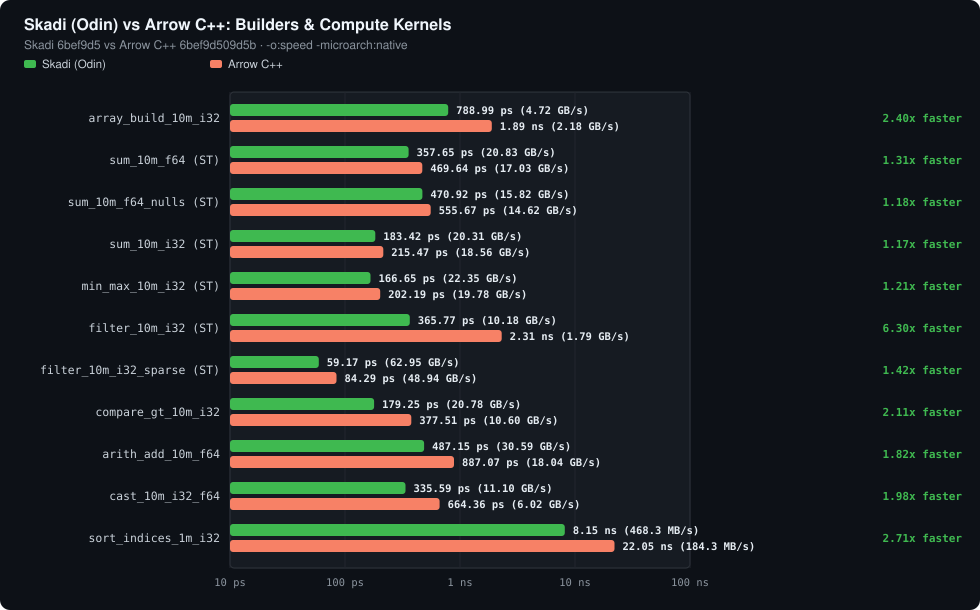
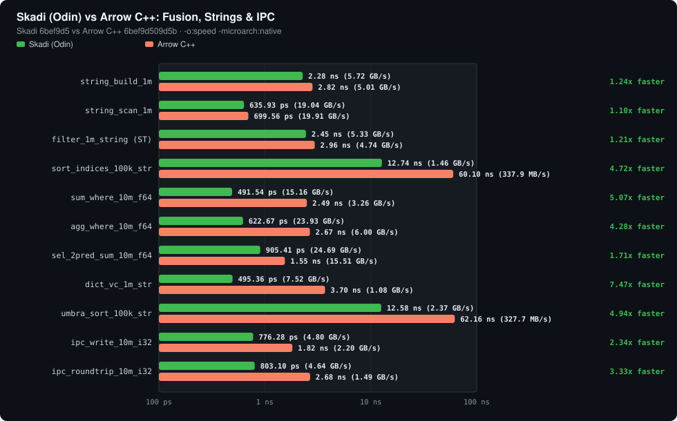
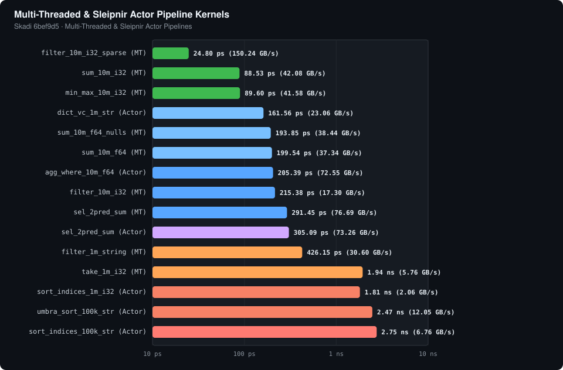

[Root README](../README.md) · **Suite Renders** · [Detailed 1v1 & PyArrow Report](RESULTS.md)

# Skadi Benchmarks & Visual Renders

Pure-Odin SIMD Arrow compute, compressed encodings (`Umbra_Array`, `RLE_Array`, `Dict_Array`), Sleipnir actor pipeline, and zero-copy `mmap`/`writev` IPC benchmark suite for **Skadi** (`42` Odin benchmarks across `6` groups, `292` samples in [`history.hugidb`](history.hugidb), paired with `26` Arrow C++ baselines at `6bef9d509d5b`), with visual SVG charts rendered via [`runa`](https://github.com/boxxxie/runa) under [`renders/`](renders/).

---

## Visual Renders (`-o:speed`)

### 1. Skadi (Odin) vs Arrow C++: Builders & Compute Kernels



### 2. Skadi (Odin) vs Arrow C++: Fusion, Strings, Encodings & Zero-Copy IPC



### 3. Multi-Threaded & Sleipnir Actor Pipeline Speedups



---

## Reproducing & Regenerating Renders

```bash
# 1. Run the 1v1 Odin vs Arrow C++ statistical suite (requires PyArrow / Arrow C++)
make bench-1v1

# 2. Or run Odin benchmarks directly via hugi and append to benchmarks/history.hugidb
hugi run benchmarks/odin --runs 5 --warmup 1

# 3. Statistically compare the last two commits (Mann-Whitney U / Welch t-test)
hugi compare --last --db benchmarks/history.hugidb

# 4. Run 3-way Skadi / PyArrow / Arrow C++ comparison
bash benchmarks/compare.sh

# 5. Regenerate SVG charts in benchmarks/renders/ and tables below using runa AOT templates
odin run benchmarks/render -collection:runa=../runa
```

---

## Full Odin Benchmark Results (`42` Benchmarks)

<!-- BEGIN_BENCHMARK_TABLE -->
### `builders` — Contiguous Primitive Array Builders (`1` benchmarks)

Typed contiguous primitive builders with `0 B` unnecessary intermediate copies.

| Benchmark | Median (`p50`) | `P95` | Throughput / Ops | `CV%` | vs Arrow C++ | Allocs / op |
| :--- | ---: | ---: | ---: | ---: | ---: | ---: |
| `array_build_10m_i32` | **788.99 ps** | 797.26 ps | 4.72 GB/s | 1.9% | **2.40x** (1.89 ns) | 0.0 (4 B) |
### `compute` — Single-Threaded, Multi-Threaded & Actor Compute Kernels (`21` benchmarks)

SIMD reductions, min/max, sparse/dense filters, casts, take, and radix index sorts.

| Benchmark | Median (`p50`) | `P95` | Throughput / Ops | `CV%` | vs Arrow C++ | Allocs / op |
| :--- | ---: | ---: | ---: | ---: | ---: | ---: |
| `sum_10m_f64_st` | **357.65 ps** | 383.26 ps | 20.83 GB/s | 8.5% | **1.31x** (469.64 ps) | **0** |
| `sum_10m_f64_mt` | **199.54 ps** | 210.74 ps | 37.34 GB/s | 3.7% | — | **0** |
| `sum_10m_f64_nulls_st` | **470.92 ps** | 557.22 ps | 15.82 GB/s | 12.8% | **1.18x** (555.67 ps) | **0** |
| `sum_10m_f64_nulls_mt` | **193.85 ps** | 202.61 ps | 38.44 GB/s | 2.2% | — | **0** |
| `sum_10m_i32_st` | **183.42 ps** | 195.16 ps | 20.31 GB/s | 3.8% | **1.17x** (215.47 ps) | **0** |
| `sum_10m_i32_mt` | **88.53 ps** | 102.53 ps | 42.08 GB/s | 7.3% | — | **0** |
| `min_max_10m_i32_st` | **166.65 ps** | 183.43 ps | 22.35 GB/s | 6.0% | **1.21x** (202.19 ps) | **0** |
| `min_max_10m_i32_mt` | **89.60 ps** | 102.05 ps | 41.58 GB/s | 7.9% | — | **0** |
| `filter_10m_i32_st` | **365.77 ps** | 377.41 ps | 10.18 GB/s | 1.9% | **6.30x** (2.31 ns) | 0.0 (2 B) |
| `filter_10m_i32_mt` | **215.38 ps** | 223.99 ps | 17.30 GB/s | 3.0% | — | 0.0 (2 B) |
| `compare_gt_10m_i32` | **179.25 ps** | 185.17 ps | 20.78 GB/s | 2.0% | **2.11x** (377.51 ps) | 0.0 (0 B) |
| `arith_add_10m_f64` | **487.15 ps** | 553.67 ps | 30.59 GB/s | 7.0% | **1.82x** (887.07 ps) | 0.0 (8 B) |
| `cast_10m_i32_f64` | **335.59 ps** | 343.00 ps | 11.10 GB/s | 1.6% | **1.98x** (664.36 ps) | 0.0 (8 B) |
| `take_1m_i32` | **12.49 ns** | 12.87 ns | 80.07M/s | 3.9% | **0.50x** (6.28 ns) | **0** |
| `take_1m_i32_st` | **6.53 ns** | 7.52 ns | 1.71 GB/s | 8.0% | **0.96x** (6.28 ns) | 0.0 (4 B) |
| `sort_indices_1m_i32` | **8.15 ns** | 8.39 ns | 468.3 MB/s | 2.2% | **2.71x** (22.05 ns) | 0.0 (8 B) |
| `take_1m_i32_mt` | **1.94 ns** | 2.75 ns | 5.76 GB/s | 18.6% | — | 0.0 (4 B) |
| `compare_gt_10m_f64` | **366.62 ps** | 377.76 ps | 20.32 GB/s | 2.5% | **1.52x** (556.31 ps) | 0.0 (0 B) |
| `filter_10m_i32_sparse_st` | **59.17 ps** | 66.38 ps | 62.95 GB/s | 27.0% | **1.42x** (84.29 ps) | 0.0 (0 B) |
| `filter_10m_i32_sparse_mt` | **24.80 ps** | 27.01 ps | 150.24 GB/s | 16.9% | — | 0.0 (0 B) |
| `sort_indices_1m_i32_actor` | **1.81 ns** | 1.86 ns | 2.06 GB/s | 9.0% | — | 0.0 (8 B) |
### `strings` — Variable-Length String Build, Scan, Filter & Sort (`6` benchmarks)

Offset-indexed string buffers, vectorized prefix/equality scans, and actor string sorts.

| Benchmark | Median (`p50`) | `P95` | Throughput / Ops | `CV%` | vs Arrow C++ | Allocs / op |
| :--- | ---: | ---: | ---: | ---: | ---: | ---: |
| `string_build_1m` | **2.28 ns** | 2.34 ns | 5.72 GB/s | 3.6% | **1.24x** (2.82 ns) | 0.0 (15 B) |
| `string_scan_1m` | **635.93 ps** | 688.36 ps | 19.04 GB/s | 4.1% | **1.10x** (699.56 ps) | **0** |
| `filter_1m_string_st` | **2.45 ns** | 2.48 ns | 5.33 GB/s | 1.1% | **1.21x** (2.96 ns) | 0.0 (7 B) |
| `filter_1m_string_mt` | **426.15 ps** | 640.02 ps | 30.60 GB/s | 23.2% | — | 0.0 (7 B) |
| `sort_indices_100k_str` | **12.74 ns** | 12.88 ns | 1.46 GB/s | 1.1% | **4.72x** (60.10 ns) | 0.0 (8 B) |
| `sort_indices_100k_str_actor` | **2.75 ns** | 3.24 ns | 6.76 GB/s | 25.1% | — | 0.0 (8 B) |
### `fusion` — Fused Multi-Predicate & Filter-Aggregate Operators (`6` benchmarks)

Single-pass `sum_where`, `agg_where`, and two-predicate fused pipelines without materializing bitmaps.

| Benchmark | Median (`p50`) | `P95` | Throughput / Ops | `CV%` | vs Arrow C++ | Allocs / op |
| :--- | ---: | ---: | ---: | ---: | ---: | ---: |
| `sum_where_10m_f64` | **491.54 ps** | 528.00 ps | 15.16 GB/s | 3.6% | **5.07x** (2.49 ns) | **0** |
| `agg_where_10m_f64` | **622.67 ps** | 695.53 ps | 23.93 GB/s | 7.5% | **4.28x** (2.67 ns) | **0** |
| `sel_2pred_sum_10m_f64` | **905.41 ps** | 922.30 ps | 24.69 GB/s | 1.4% | **1.71x** (1.55 ns) | **0** |
| `sel_2pred_sum_10m_f64_mt` | **291.45 ps** | 298.03 ps | 76.69 GB/s | 1.4% | — | **0** |
| `sel_2pred_sum_10m_f64_actor` | **305.09 ps** | 316.84 ps | 73.26 GB/s | 2.0% | — | **0** |
| `agg_where_10m_f64_actor` | **205.39 ps** | 219.69 ps | 72.55 GB/s | 4.4% | — | **0** |
### `encoding` — `Dict_Array`, `RLE_Array` & `Umbra_Array` Compressed Kernels (`5` benchmarks)

Dictionary value coding, constant-time RLE reductions, and 12B German-style Umbra string sorting.

| Benchmark | Median (`p50`) | `P95` | Throughput / Ops | `CV%` | vs Arrow C++ | Allocs / op |
| :--- | ---: | ---: | ---: | ---: | ---: | ---: |
| `dict_vc_1m_str` | **495.36 ps** | 501.74 ps | 7.52 GB/s | 1.1% | **7.47x** (3.70 ns) | **0** |
| `rle_sum_10m_f64` | **0.77 ps** | 0.78 ps | 15.58 GB/s | 1.6% | **630.08x** (485.17 ps) | **0** |
| `umbra_sort_100k_str` | **12.58 ns** | 13.74 ns | 2.37 GB/s | 4.6% | **4.94x** (62.16 ns) | 0.0 (8 B) |
| `umbra_sort_100k_str_actor` | **2.47 ns** | 2.93 ns | 12.05 GB/s | 13.3% | — | 0.0 (8 B) |
| `dict_vc_1m_str_actor` | **161.56 ps** | 168.61 ps | 23.06 GB/s | 2.3% | — | **0** |
### `ipc` — Zero-Copy Vectored `writev` & Lazy `mmap` Arrow IPC (`3` benchmarks)

Zero-copy IPC serialization and memory-mapped Arrow file reads with zero buffer copies.

| Benchmark | Median (`p50`) | `P95` | Throughput / Ops | `CV%` | vs Arrow C++ | Allocs / op |
| :--- | ---: | ---: | ---: | ---: | ---: | ---: |
| `ipc_roundtrip_10m_i32` | **803.10 ps** | 839.13 ps | 4.64 GB/s | 3.8% | **3.33x** (2.68 ns) | **0** |
| `ipc_write_10m_i32` | **776.28 ps** | 832.70 ps | 4.80 GB/s | 3.4% | **2.34x** (1.82 ns) | **0** |
| `ipc_read_mmap_10m_i32` | **0.89 ps** | 1.08 ps | 4.11 TB/s | 10.5% | **13.01x** (11.52 ps) | **0** |
<!-- END_BENCHMARK_TABLE -->
